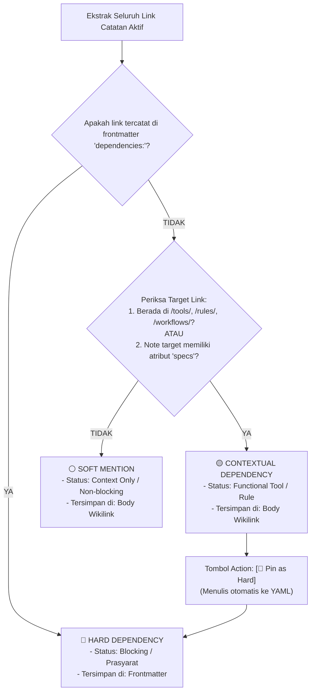

# 📋 Brief: 3-Tier Dependency Triage & Interactive Right Sidepanel Inspector

> **Feature Status**: `0` (Draft / Pending Implementation)  
> **Target Module**: `pakcli-panel` (`panel`)  
> **UI Target**: Right Sidepanel View (`ItemView` / Mobile Slide-over Drawer)  
> **Platform**: Obsidian Desktop & Mobile  
> **Date**: 2026-10-23  

---

## 1. Executive Summary & Core Objective

Sering kali pengguna merasa terbebani untuk membedakan dependensi teknis mana yang harus dimasukkan ke frontmatter YAML (`dependencies: [...]`) dan mana yang cukup disebut di dalam teks biasa. Jika semua wikilink disedot mentah-mentah, daftar perbandingan (*Compare Hub* & *Venn Diagram*) menjadi penuh sampah (*bloated*).

Fitur ini menghadirkan **3-Tier Dependency Triage Engine** dan **Interactive Right Sidepanel Inspector** dengan **Dual View Modes (`Grouped` vs `Ungrouped`)**, **3 Quick Scope Radio Buttons**, dan **Smart Dropdown Sorter**:
1. **Menghilangkan Friksi Pengetikan**: Deteksi otomatis link berbasis folder (`/tools/`, `/rules/`, `/workflows/`) dan keberadaan properti `specs`.
2. **Dual View Presentation**:
   - 🗂️ **Mode `Grouped`**: Tampilan triage terstruktur dalam 3 tier (Hard, Contextual, Soft).
   - 📜 **Mode `Ungrouped`**: Tampilan flat cascading stream (mirip layout `panel-tree-postit-cascading`) dengan kontrol radio filter instan.
3. **3 Radio Buttons Filter (Saat Mode `Ungrouped`)**:
   - `🔘 All`: Tampilkan semua jenis link (Hard + Contextual + Soft).
   - `🔘 Essential`: Hanya tampilkan link penting (Hard 🔴 + Contextual 🟡).
   - `🔘 Hard Only`: Isolasi murni link prasyarat mutlak (Hard 🔴).
4. **Smart Dropdown Sorter**:
   - ⏳ *Pertama Mention* (First Mentioned $\rightarrow$ Last Mentioned): Sesuai kronologi urutan baris di teks.
   - ⌛ *Terakhir Mention* (Reverse Order).
   - 🔥 *Popular / Frequency*: Link yang paling sering di-mention di dalam dokumen naik ke atas.
   - 🔤 *A - Z* dan *Z - A*: Urutan abjad.
5. **1-Klik Promotion (`📌 Pin to Hard`)**: Mengubah link body menjadi dependensi frontmatter YAML seketika tanpa scroll manual.

---

## 2. Definisi 3 Tingkat Dependensi & Penyimpanan Fisiknya

Semua data tersimpan secara alami di dalam satu file Markdown lokal tanpa database eksternal:

| Kategori | Lokasi Penyimpanan Fisik di `.md` | Logika Identifikasi Otomatis oleh Panel | Peran di Compare Hub |
| :--- | :--- | :--- | :--- |
| **🔴 Hard Dependency** | **Frontmatter YAML** (`dependencies: [...]`) | Tertulis eksplisit di blok metadata atas, ATAU dinaikkan melalui tombol `[Pin to Hard]`. | **Mutlak/Prasyarat Utama**: Masuk ke baris tabel perbandingan & simpul utama Venn. |
| **🟡 Contextual Dependency** | **Body Teks Markdown** (`[[wikilink]]` biasa) | Link menunjuk ke folder `/tools/`, `/rules/`, `/workflows/`, **ATAU** note target memiliki properti `specs` terstruktur. | **Fungsional / Alat**: Masuk sebagai pelengkap komparasi alat & aturan SOP. |
| **⚪ Soft Mention** | **Body Teks Markdown** (`[[wikilink]]` biasa) | Link menunjuk ke catatan umum tanpa spesifikasi teknis (hanya artikel narasi/sejarah/referensi sampingan). | **Diabaikan dari Compare**: Hanya tampil di daftar referensi sampingan (collapsed). |

---

## 3. Alur Kerja Logika & Decision Tree



---

## 4. Desain UI/UX: Interactive Right Sidepanel

Panel ini terdaftar sebagai Obsidian Native `ItemView` (`viewType: 'pakcli-dependency-inspector'`) dan selalu sinkron dengan catatan aktif (`active-leaf-change`).

### A. Desktop Right Sidepanel Wireframe

#### 1. Header Toolbar (Mode Switcher + Sorter)
```text
┌─────────────────────────────────────────────────────────┐
│ 🧭 DEPENDENCY INSPECTOR                                 │
│ File: esp32-firmware-flash.md                           │
├─────────────────────────────────────────────────────────┤
│ [ 🗂️ Grouped | 📜 Ungrouped ]   ▼ [ ⏳ Pertama Mention ]│
│                                                         │
│ (Jika Ungrouped Aktif, Muncul 3 Radio Buttons):        │
│ (•) All (7)      ( ) Essential (4)      ( ) Hard (2)    │
│                                                         │
│ 🔍 [ Cari link...                                     ] │
├─────────────────────────────────────────────────────────┤
```

#### 2. Tampilan Mode `Grouped` (Triage View)
```text
│ 🔴 HARD DEPENDENCIES (2) [Frontmatter]                  │
│ ┌─────────────────────────────────────────────────────┐ │
│ │ 🔴 [[esptool.py]]                                  │ │
│ │    Runtime • Python Package                         │ │
│ │    [Unpin ✖]                                       │ │
│ ├─────────────────────────────────────────────────────┤ │
│ │ 🔴 [[kabel-data-3.3v]]                              │ │
│ │    Hardware • USB-C Data Cable                      │ │
│ │    [Unpin ✖]                                       │ │
│ └─────────────────────────────────────────────────────┘ │
│                                                         │
│ 🟡 CONTEXTUAL TOOLS & RULES (2) [Has Specs]             │
│ ┌─────────────────────────────────────────────────────┐ │
│ │ 🛠️ [[tools/hardware/esp32-s3]]                      │ │
│ │    Specs: Xtensa Dual-Core, 3.3V Logic              │ │
│ │    Line 12 • [📌 Pin as Hard]                      │ │
│ ├─────────────────────────────────────────────────────┤ │
│ │ 📜 [[rules/anti-static-esd]]                        │ │
│ │    Rule: Warning (Gunakan Gelang ESD)               │ │
│ │    Line 28 • [📌 Pin as Hard]                      │ │
│ └─────────────────────────────────────────────────────┘ │
│                                                         │
│ ▷ ⚪ SOFT MENTIONS (2) [Narrative Only - Collapsed]     │
│   • [[sejarah-mikrokontroler]] (Line 35)                │
│   • [[forum-esp32-reddit]] (Line 42)                    │
```

#### 3. Tampilan Mode `Ungrouped` (Cascading Stream with Post-It Style)
```text
│ 📜 UNGROUPED STREAM [Filter: Essential | Sort: Pertama] │
│ ├── 🔴 [[esptool.py]]             Line 3   # Python CLI │
│ ├── 🔴 [[kabel-data-3.3v]]        Line 5   # Hardware   │
│ ├── 🟡 [[tools/hardware/esp32-s3]] Line 12  # DevBoard   │
│ └── 📜 [[rules/anti-static-esd]]  Line 28  # SafetySOP  │
│                                                         │
│ (Soft mentions disembunyikan karena radio: Essential)   │
├─────────────────────────────────────────────────────────┤
│ [ ⚖️ Send Clean Data to Compare Hub ]                   │
└─────────────────────────────────────────────────────────┘
```

---

## 5. Fitur Interaksi Kunci

1. **Dual View Switcher (`Grouped` vs `Ungrouped`)**:
   - `Grouped`: Mengelompokkan item ke dalam kotak accordion per tier.
   - `Ungrouped`: Mengalirkan seluruh item dalam satu stream pohon hirarki linear.
2. **3 Radio Buttons Scope (Khusus Mode Ungrouped)**:
   - **`🔘 All`**: Menampilkan seluruh wikilink tanpa terkecuali.
   - **`🔘 Essential`**: Memotong soft mentions, hanya menampilkan alat dan aturan operasional (🔴 + 🟡).
   - **`🔘 Hard Only`**: Hanya menampilkan dependensi mutlak yang ada di YAML (🔴).
3. **Dropdown Sorter 4 Pilihan**:
   - `⏳ Pertama Mention`: Berdasarkan baris terkecil (`link.position.start.line`).
   - `⌛ Terakhir Mention`: Berdasarkan baris terbesar (kebalikan).
   - `🔥 Popular (Frequency)`: Berdasarkan jumlah kali link disebut di dalam teks (`count`).
   - `🔤 A-Z / Z-A`: Alfabetis berdasarkan nama file link.
4. **1-Klik Pinning / Unpinning**:
   - Tombol `[📌 Pin as Hard]` otomatis menyisipkan item ke blok frontmatter `dependencies: [...]`.
   - Tombol `[✖ Unpin]` menghapus item dari frontmatter dan mengembalikannya ke status kontekstual.
5. **Mobile Responsiveness**:
   - Mendukung gesture pull drawer dari tepi kanan atau bottom sheet di Obsidian Mobile.
   - Radio buttons berbentuk touch-friendly segmented chips.

---

## 6. Implementation & Verification Gates

- [x] Brief Status 0 diperbarui dengan Dual View Mode, 3 Radio Buttons, dan Dropdown Sorter.
- [ ] Implementasi Triage Engine di `panel/src/features/tierlist/utils/dependency-triage.ts`:
  - `triageDependencies(app, activeFile)`
  - Sorting logic: `byFirstMention`, `byLastMention`, `byFrequency`, `byAlpha`.
  - Radio filtering: `all`, `essential`, `hardOnly`.
- [ ] Implementasi View Component `DependencyInspectorView.ts`:
  - Registrasi leaf sidepanel kanan (`viewType: 'pakcli-dependency-inspector'`).
  - Switcher tab `Grouped` vs `Ungrouped`.
  - Radio button group component.
  - Handler tombol interaktif `pinToFrontmatter()` dan `unpinFromFrontmatter()`.
- [ ] Integrasi visual tree cascading (mengadopsi styling `panel-tree-postit-cascading`).
- [ ] Verifikasi Build: Jalankan `npm run build` di `panel/` dengan 0 error kompilasi dan ukuran bundle $< 5.0\text{ MB}$.
- [ ] Update Brief Status ke `1` (Implemented).
