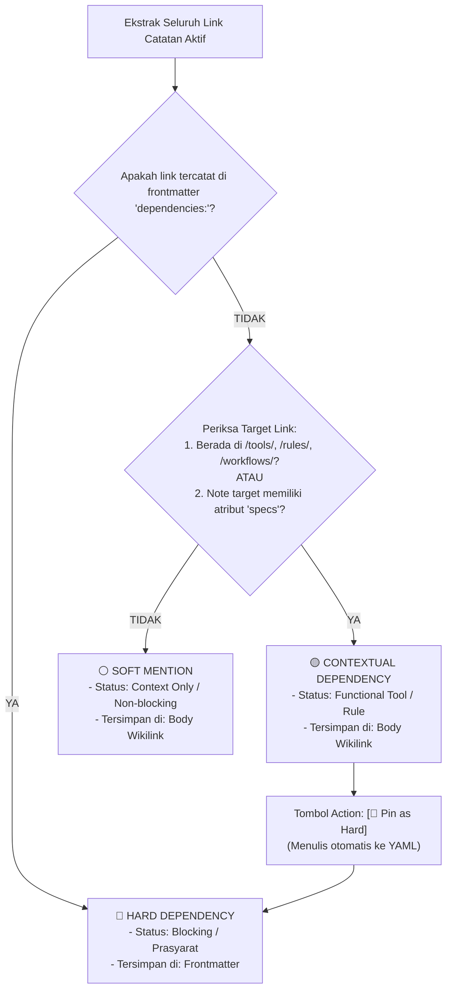

# 📋 Brief: 3-Tier Dependency Triage & Interactive Right Sidepanel Inspector

> **Feature Status**: `0` (Draft / Pending Implementation)  
> **Target Module**: `pakcli-panel` (`panel`)  
> **UI Target**: Right Sidepanel View (`ItemView` / Mobile Slide-over Drawer)  
> **Platform**: Obsidian Desktop & Mobile  
> **Date**: 2026-10-22  

---

## 1. Executive Summary & Core Objective

Sering kali pengguna merasa terbebani untuk membedakan dependensi teknis mana yang harus dimasukkan ke frontmatter YAML (`dependencies: [...]`) dan mana yang cukup disebut di dalam teks biasa. Jika semua wikilink disedot mentah-mentah, daftar perbandingan (*Compare Hub* & *Venn Diagram*) menjadi penuh sampah (*bloated*).

Fitur ini menghadirkan **3-Tier Dependency Triage Engine** dan **Interactive Right Sidepanel Inspector**:
1. Menghilangkan friksi pengetikan frontmatter manual dengan sistem deteksi otomatis berbasis lokasi file & keberadaan properti `specs`.
2. Menyediakan panel interaktif di sebelah kanan (Desktop) dan slide-over drawer (Mobile) untuk memantau, memfilter, serta mengubah status dependensi secara instan dengan **1-Klik Promotion (`Pin to Frontmatter`)**.
3. Memastikan Compare Hub dan Venn Diagram hanya memproses dependensi yang benar-benar relevan tanpa intervensi konfigurasi yang rumit.

---

## 2. Definisi 3 Tingkat Dependensi & Penyimpanan Fisiknya

Semua data tersimpan secara alami di dalam satu file Markdown lokal tanpa database eksternal:

| Kategori | Lokasi Penyimpanan Fisik di `.md` | Logika Identifikasi Otomatis oleh Panel | Peran di Compare Hub |
| :--- | :--- | :--- | :--- |
| **🔴 Hard Dependency** | **Frontmatter YAML** (`dependencies: [...]`) | Tertulis eksplisit di blok metadata atas, ATAU dinaikkan melalui tombol `[Pin to Hard]`. | **Mutlak/Prasyarat Utama**: Masuk ke baris tabel perbandingan & simpul utama Venn. |
| **🟡 Contextual Dependency** | **Body Teks Markdown** (`[[wikilink]]` biasa) | Link menunjuk ke folder `/tools/`, `/rules/`, `/workflows/`, **ATAU** note target memiliki properti `specs` terstruktur. | **Fungsional / Alat**: Masuk sebagai pelengkap komparasi alat & aturan SOP. |
| **⚪ Soft Mention** | **Body Teks Markdown** (`[[wikilink]]` biasa) | Link menunjuk ke catatan umum tanpa spesifikasi teknis (hanya artikel narasi/sejarah/referensi sampingan). | **Diabaikan dari Compare**: Hanya tampil di daftar referensi sampingan (collapsed). |

---

## 3. Alur Kerja Logika & Decision Tree



---

## 4. Desain UI/UX: Interactive Right Sidepanel

Panel ini terdaftar sebagai Obsidian Native `ItemView` (`viewType: 'pakcli-dependency-inspector'`) dan selalu sinkron dengan catatan aktif (`active-leaf-change`).

### A. Desktop Right Sidepanel Wireframe & Layout

```text
┌─────────────────────────────────────────────────────────┐
│ 🧭 DEPENDENCY INSPECTOR                                 │
│ File: esp32-firmware-flash.md                           │
│ [ All (7) ] [ 🔴 Hard (2) ] [ 🟡 Tools (3) ] [ ⚪ (2) ] │
├─────────────────────────────────────────────────────────┤
│ 🔴 HARD DEPENDENCIES (2) [Frontmatter]                  │
│ ┌─────────────────────────────────────────────────────┐ │
│ │ 🔴 [[esptool.py]]                                  │ │
│ │    Runtime • Python Package                         │ │
│ │    [Unpin ✖]                                       │ │
│ ├─────────────────────────────────────────────────────┤ │
│ │ 🔴 [[kabel-data-3.3v]]                              │ │
│ │    Hardware • USB-C Data Cable                      │ │
│ │    [Unpin ✖]                                       │ │
│ └─────────────────────────────────────────────────────┘ │
│                                                         │
│ 🟡 CONTEXTUAL TOOLS & RULES (3) [Has Specs]             │
│ ┌─────────────────────────────────────────────────────┐ │
│ │ 🛠️ [[tools/hardware/esp32-s3]]                      │ │
│ │    Specs: Xtensa Dual-Core, 3.3V Logic              │ │
│ │    Line 12 • [📌 Pin as Hard]                      │ │
│ ├─────────────────────────────────────────────────────┤ │
│ │ 📜 [[rules/anti-static-esd]]                        │ │
│ │    Rule: Warning (Gunakan Gelang ESD)               │ │
│ │    Line 28 • [📌 Pin as Hard]                      │ │
│ └─────────────────────────────────────────────────────┘ │
│                                                         │
│ ▷ ⚪ SOFT MENTIONS (2) [Narrative Only - Collapsed]     │
│   • [[sejarah-mikrokontroler]] (Line 35)                │
│   • [[forum-esp32-reddit]] (Line 42)                    │
├─────────────────────────────────────────────────────────┤
│ [ ⚖️ Send Clean Data to Compare Hub ]                   │
└─────────────────────────────────────────────────────────┘
```

### B. Fitur Interaksi Kunci
1. **Interactive Promotion (`📌 Pin as Hard`)**:
   - Jika pengguna menemukan bahwa suatu alat di body teks ternyata merupakan prasyarat mutlak, cukup klik tombol `[📌 Pin as Hard]`.
   - Sidepanel secara otomatis memperbarui blok YAML di file `.md` tanpa memindahkan posisi kursor atau mengganggu pengetikan.
2. **Interactive Demotion (`✖ Unpin`)**:
   - Menghapus item dari frontmatter dan mengembalikannya sebagai sebutan di body teks.
3. **Smart Target Preview**:
   - Menampilkan ringkasan singkat `specs` dari note tujuan langsung di kartu Sidepanel (hover preview).

### C. Responsivitas Mobile (Bottom/Right Drawer)
- Di perangkat mobile/tablet, panel dapat diakses via **slide gesture** dari tepi kanan atau melalui status bar icon.
- Tampilan disederhanakan dengan tab horizontal dan target sentuh minimal $44\text{px} \times 44\text{px}$.

---

## 5. Implementasi & Verifikasi

- [x] Brief Status 0 diperbarui di `panel/docs/brief-3tier-dependencies-sidepanel.md`.
- [ ] Implementasi Triage Engine di `panel/src/features/tierlist/utils/dependency-triage.ts`:
  - `triageDependencies(app, activeFile)`
  - Verifikasi folder (`tools/`, `rules/`, `workflows/`) dan cache specs.
- [ ] Implementasi View Component `DependencyInspectorView.ts`:
  - Registrasi leaf sidepanel kanan.
  - Handler tombol interaktif `pinToFrontmatter()` dan `unpinFromFrontmatter()`.
- [ ] Verifikasi Build: Jalankan `npm run build` di `panel/` dengan 0 error kompilasi dan ukuran bundle $< 5.0\text{ MB}$.
- [ ] Ubah status brief ke `1` (Implemented).
