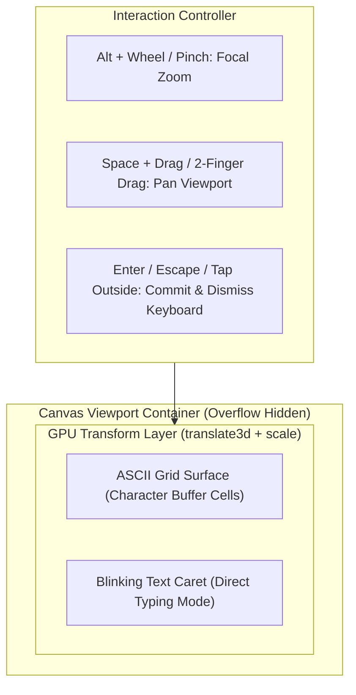

# 📌 Master Brief: Photoshop-Grade Controls, Mobile Gestures & Direct Typing for ASCII Studio (`pakcli-panel`)

> **Feature Status**: `0` (Draft / Pending Implementation)  
> **Target Module**: `pakcli-panel` (`src/features/asciidraw`)  
> **Platform**: Obsidian Desktop & Mobile (`obsidian` API / CSSOM / Pointer Events / Touch Gestures)  
> **Date**: 2026-10-13  

---

## 1. Executive Summary & Problem Analysis

### 🚨 Current Friction Points
1. **Unintuitive Zooming**:
   - Zoom hanya bisa diakses via tombol klik manual `+` / `−` di top navbar.
   - Transform terkunci di pojok kiri atas (`transform-origin: top left`), sehingga kanvas melayang ke kanan-bawah saat diperbesar, bukan terpusat pada kursor mouse (*focal-point zoom*).
   - Setiap kali zoom berubah, sistem menghapus dan merekonstruksi ribuan elemen `<span>` DOM sel (`renderCanvas()`), membuat zoom terasa lag dan tidak 60 FPS.
2. **Tidak Ada Hand Tool / Infinite Pan**:
   - Tidak ada gestur geser kanvas bebas seperti Photoshop (`Space + Left Drag` atau klik tengah mouse). Kanvas terkunci di layout wrapper pasif.
3. **Keterbatasan Mobile (Kurang Responsif)**:
   - Tidak ada dukungan *pinch-to-zoom* 2 jari dan *two-finger pan* di layar sentuh.
   - UI toolbar samping dan layer panel memakan terlalu banyak ruang horizontal di layar HP.
4. **Pengetikan Teks Kaku di Grid**:
   - Mengisi teks di diagram ASCII masih repot. Belum ada fitur klik cell langsung ketik kalimat (*Type Tool*), dan di mobile keyboard virtual sering menutupi kanvas dan tidak otomatis tertutup saat selesai mengetik.

---

## 2. Proposed Architecture & Photoshop Standards

### A. Desktop Controls (Photoshop / Figma Standard)
- **Smooth Wheel Zoom ke Arah Kursor**:
  - `Alt + Wheel` (atau `Ctrl + Wheel`) memperbesar/memperkecil kanvas langsung ke koordinat mouse (`focalPointX`, `focalPointY`).
- **Spacebar Hand Tool & Middle Click Pan**:
  - Menahan tombol `Space` mengubah kursor menjadi `grab` / `grabbing` dan mengalihkan klik kiri menjadi pan kanvas (`panX`, `panY`).
  - Klik tengah mouse (*middle click drag*) dapat melakukan pan secara instan tanpa perlu menekan Space.
- **Hardware-Accelerated Transform**:
  - Kanvas dibungkus dalam viewport wrapper yang digerakkan murni via GPU CSS:
    ```css
    transform: translate3d(${panX}px, ${panY}px, 0) scale(${zoomScale});
    transform-origin: 0 0;
    ```
  - **Zero DOM re-rendering** saat zoom/pan berlangsung, menjamin 60 FPS mulus.
- **Shortcuts Standar**:
  - `Ctrl + 0`: Fit to Viewport (kanvas otomatis dipusatkan dan dihitung scale-nya agar pas di layar).
  - `Ctrl + 1`: Actual Size (reset scale ke `1.0` / 100%).

### B. Mobile Touch Gestures & Responsive UI
- **Multi-Touch Gestures**:
  - **Pinch-to-zoom (2 jari)**: Menghitung jarak antar 2 jari untuk zoom in/out dinamis.
  - **Two-finger drag**: Menggeser kanvas (*pan*) tanpa mencoret grid.
- **Mobile-Adaptive Layout**:
  - Pada layar HP (`Platform.isMobile` atau lebar layar `< 768px`):
    - Toolbar kiri dan sidebar layer diringkas menjadi collapsible drawer / bottom sheet.
    - Viewport kanvas mendapatkan prioritas area layar maksimal.

### C. Direct Grid Typing & Keyboard Dismissal Lifecycle
- **Inline Text Tool (`T`)**:
  - Klik pada sembarang cell di kanvas memunculkan caret teks aktif (`_` atau `█`).
  - Mengetik keyboard langsung menulis karakter ke buffer ASCII baris tersebut secara horizontal.
  - Mendukung `Backspace` untuk menghapus dan menggeser caret ke kiri.
- **Auto-Dismiss Virtual Keyboard**:
  - Saat pengguna menekan `Enter`, `Escape`, atau mengetuk area di luar input teks:
    - Teks otomatis di-commit ke layer buffer.
    - Input tersembunyi langsung di-`blur()`.
    - Virtual keyboard mobile langsung tertutup rapi (*dismissed*) sehingga kanvas kembali terlihat penuh tanpa terpotong keyboard.

---

## 3. UI/UX Hierarchy Diagram (Mermaid)



---

## 4. Implementation Plan & Target Files

| Target File | Rencana Perubahan |
| :--- | :--- |
| `panel/src/features/asciidraw/ui/AsciiDrawModal.ts` | Tambahkan state `panX`, `panY`, event listener Wheel zoom to cursor, Spacebar hand tool, Touch pinch/pan, dan inline text editing controller. |
| `panel/src/styles/asciidraw.scss` | Styling untuk `transform3d` wrapper, touch-action gestures, mobile bottom-sheet drawer, dan caret blinking teks. |
| `panel/docs/brief-asciidraw-photoshop-controls-and-mobile-typing.md` | Master Brief & Lifecycle Tracker (Status 0 -> 1). |

---

## 5. Acceptance Criteria Checklist

- [ ] Status 0 brief dibuat dan di-commit ke git.
- [ ] `Alt + Wheel` / `Ctrl + Wheel` melakukan zoom tepat ke arah posisi kursor mouse.
- [ ] Tahan `Spacebar` + Drag Kiri atau Klik Tengah Mouse dapat menggeser (*pan*) kanvas bebas.
- [ ] Zoom dan Pan menggunakan GPU CSS transform tanpa re-render DOM cell (60 FPS).
- [ ] Pintasan `Ctrl + 0` (Fit Viewport) dan `Ctrl + 1` (100% Actual Size) aktif.
- [ ] Dukungan mobile pinch-to-zoom (2 jari) dan two-finger pan berfungsi mulus.
- [ ] Text Tool (`T`) memungkinkan klik cell dan ketik teks berurutan di grid.
- [ ] Tekan `Enter` / `Escape` / klik luar meng-commit teks dan menutup virtual keyboard mobile.
- [ ] Build `npm run build` sukses, 0 error, bundle tetap $< 5.0\text{ MB}$.
- [ ] Update brief ke Status 1 dan commit.
