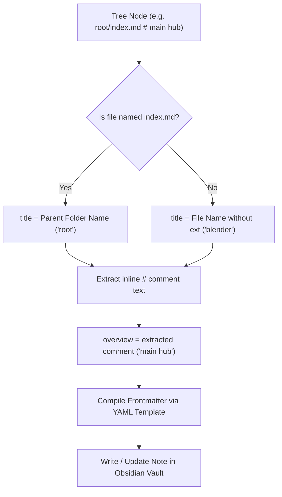

# 📌 Master Brief: Tree-to-Vault Directory Sync & Frontmatter Scaffolder (panel-tree-vault-sync)

> **Feature Status**: `0` (Draft / Pending Implementation)  
> **Target Module**: `pakcli-panel` (`panel`)  
> **Platform**: Obsidian Desktop & Mobile  
> **Date**: 2026-10-23  

---

## 1. Objective & Problem Statement

### Problem
Users frequently design project taxonomies, directory layouts, and documentation blueprints inside `panel-tree` blocks. However:
1. **Manual Scaffolding Friction**: Turning a text tree into real folders and `.md` notes requires tedious manual creation or fragile external terminal scripts.
2. **Missing Bi-Directional Synergy**: Once a tree is created, changes made directly to vault files or folders (e.g. renaming files, adding assets) do not reflect back in the note's codeblock, causing documentation drift.
3. **No Read-Only Directory Mirrors**: Users who want to embed an interactive, live outliner of an existing vault folder cannot do so safely without risking accidental text edits.
4. **Frontmatter Fragmentation**: Manually created files often lack standardized metadata, and inline `# notes` (e.g. `# untuk3d`) are lost instead of populating note properties.

### Solution
Implement **`panel-tree-vault-sync`** with **3 Distinct Operational Sync Modes**:
1. **Mode 1: Two-Way Bidirectional Sync (`sync-both` / `sync-to-both`)**:
   - Continuous two-way synchronization between codeblock text and actual vault files/folders.
   - Adding/editing in codeblock updates vault; modifying/adding files in vault updates the codeblock.
2. **Mode 2: One-Way Tree to Vault (`sync-to-vault`)**:
   - Codeblock is the master scaffold blueprint.
   - Pushes folders, notes, and frontmatter to the vault. Vault modifications never overwrite the codeblock.
3. **Mode 3: One-Way Vault to Note (`sync-to-note`) — Read-Only & Selectable**:
   - Live mirror of a target vault directory projected into the note.
   - **Read-Only**: Prevents accidental typing or desyncing.
   - **Selectable & Interactive**: Nodes are keyboard-navigable, selectable, clickable (opens file in new leaf/split), with right-click contextual actions.
   - Automatically re-renders when vault files change.

---

## 2. The 3 Sync Modes: Architecture & Comparison

| Mode | Aliases | Source of Truth | Direction | Tree Mutability | Ideal Use Case |
| :--- | :--- | :--- | :---: | :---: | :--- |
| **Two-Way Sync** | `panel-tree-sync-both`<br>`panel-tree-sync-to-both` | Co-equal | Codeblock ⇄ Vault | Editable (Interactive) | Active project planning where files are added both via text outliner and file explorer. |
| **One-Way to Vault** | `panel-tree-sync-to-vault`<br>`panel-tree-sync-vault` | Codeblock Tree | Codeblock → Vault | Master Blueprint (Editable) | Architectural scaffolding, course outlines, and project kickoffs from markdown templates. |
| **One-Way to Note** | `panel-tree-sync-to-note`<br>`panel-tree-sync-note` | Vault Directory | Vault → Codeblock | **Read-Only (Selectable)** | Embedded folder dashboard, project asset explorer, live documentation hub. |

---

## 3. Frontmatter & Metadata Resolution Engine

### 3.1 Smart Title & Overview Mapping



### 3.2 Default Frontmatter Format
```yaml
---
title: "{{title}}"
overview: "{{overview}}"
created: "{{date}}"
source_tree: "{{tree_name}}"
---
```

### 3.3 Target Directory Syntax in Codeblock
The root directory can be specified explicitly on the first line or inferred:
```text
```panel-tree-sync-both: Projects/Voli-Website
data
   index.md                 # main documentation hub
   asset
      player
         yolla.webp
         tisya.webp
   matches.md               # jadwal pertandingan dan skor
```
```

- If `Projects/Voli-Website` is specified, sync operations map to `Vault/Projects/Voli-Website/`.
- If omitted, defaults to the folder containing the current markdown active file.

---

## 4. Mode-Specific Behavior Specifications

### 4.1 Mode 1: Two-Way Bidirectional Sync (`sync-both` / `sync-to-both`)
- **Codeblock → Vault**:
  - Adding a file/folder via inline badges (`[+File]`, `[+Folder]`) or direct typing creates the corresponding file/folder in the vault.
  - Adding `# note` writes or updates the `overview:` frontmatter property.
- **Vault → Codeblock**:
  - Vault listener (`vault.on('create')`, `vault.on('delete')`, `vault.on('rename')`) updates the codeblock text in real time.
  - Debounced (300ms) with loopback suppression to prevent infinite feedback loops.

### 4.2 Mode 2: One-Way Tree to Vault (`sync-to-vault`)
- **Master Blueprint Push**:
  - Pushes tree nodes to the vault.
  - Non-destructive: Existing files keep their markdown body intact; only missing frontmatter keys (`title`, `overview`) are merged.
  - Top HUD contains a manual trigger: `[⚡ Sync to Vault]`.
  - Optional dry-run preview modal displaying folders and notes to be created.

### 4.3 Mode 3: One-Way Vault to Note (`sync-to-note`) — Read-Only & Selectable
- **Read-Only Guard**:
  - Text editing inside the codeblock is disabled (`contenteditable="false"` or CodeMirror read-only line decoration).
  - Clearly styled with a subtle `🔒 Live Vault Mirror (Read-Only)` status badge in the HUD.
- **Selectable & Interactive**:
  - Keyboard arrow navigation (Up/Down to navigate, Enter to open note, Space to preview).
  - Click on any file node opens the corresponding markdown note in Obsidian.
  - Hover highlights node; right-click context menu offers:
    - *Open in New Tab*
    - *Open in Split View*
    - *Copy Vault Path*
    - *Reveal in File Explorer*
- **Dynamic Vault Sync**:
  - Live listener re-renders the tree projection whenever files inside the target folder are added, moved, or deleted.

---

## 5. Plugin Settings & User Customization

Under **Settings → PakCLI Panel → Tree to Vault Synchronizer**:
1. **Default Frontmatter Template**: Full multi-line YAML template editor with token interpolation (`{{title}}`, `{{overview}}`, `{{folder}}`, `{{date}}`, `{{path}}`).
2. **Overview Key Mapping**: Configurable frontmatter key for `# comments` (Default: `overview`, can be changed to `description`, `summary`, or `note`).
3. **Overwrite Safety Protocol**:
   - `Safe Merge` (Default): Never overwrite note body; merge frontmatter properties.
   - `Prompt Before Overwrite`: Display diff modal before updating existing files.
4. **Index Note Special Rule**: Toggle whether `index.md` / `README.md` adopts the parent folder name as its `title` (Default: `true`).

---

## 6. Implementation Plan & Target Files

| File | Status | Description |
| :--- | :---: | :--- |
| `src/features/treeGrid/sync/types.ts` | ⏳ | Sync modes (`both`, `to-vault`, `to-note`), templates, and options |
| `src/features/treeGrid/sync/TreeVaultSynchronizer.ts` | ⏳ | Two-way and one-way sync engines with loopback prevention |
| `src/features/treeGrid/sync/TreeVaultWatcher.ts` | ⏳ | Vault event listeners for live folder mirroring in `sync-to-note` & `sync-both` |
| `src/features/treeGrid/sync/ReadOnlyTreeRenderer.ts` | ⏳ | Read-only selectable UI with keyboard navigation and click-to-open actions |
| `src/features/treeGrid/sync/TreeSyncModal.ts` | ⏳ | Diff preview & dry-run confirmation modal |
| `src/features/treeGrid/TreeCodeblockRenderer.ts` | ⏳ | Mode HUD banners (`[⚡ Sync]`, `[🔒 Read-Only Mirror]`) and alias dispatching |
| `src/settings.ts` | ⏳ | Frontmatter YAML template editor & sync configuration settings |
| `src/main.ts` | ⏳ | Registers codeblock processors and vault sync commands |

---

## 7. Acceptance Criteria Checklist

- [ ] Status 0 brief updated and committed in `panel/docs/`.
- [ ] 3 codeblock modes registered: `sync-both`, `sync-to-vault`, `sync-to-note`.
- [ ] `sync-to-note` renders strictly as read-only and selectable with click-to-open and keyboard navigation.
- [ ] Resolves `title` = filename, and `title` = parent folder name for `index.md`.
- [ ] Auto-maps `# notes` to frontmatter `overview` property.
- [ ] Frontmatter YAML template fully customizable via plugin settings.
- [ ] Non-destructive safe mode preserves existing note contents.
- [ ] Cross-platform support (Obsidian Desktop & Mobile vault APIs).
- [ ] Bundle size remains strictly $< 5.00\text{ MB}$.
- [ ] Status 1 completion commit and deployment verification.
