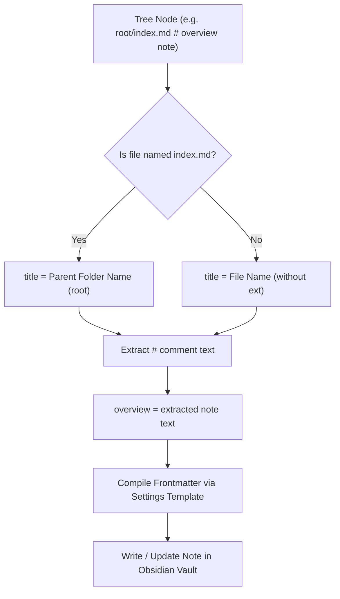

# 📌 Master Brief: Tree-to-Vault Directory Sync & Frontmatter Scaffolder (panel-tree-vault-sync)

> **Feature Status**: `0` (Draft / Pending Implementation)  
> **Target Module**: `pakcli-panel` (`panel`)  
> **Platform**: Obsidian Desktop & Mobile  
> **Date**: 2026-10-23  

---

## 1. Objective & Problem Statement

### Problem
Users frequently sketch out comprehensive project taxonomies, information architectures, and book/course outlines inside `panel-tree` blocks (e.g. `data/asset/player/index.md`, `matches.md`). However:
1. **Disconnected Skeleton vs. Vault**: The tree remains purely text inside a codeblock; creating actual Obsidian folders and `.md` notes requires tedious manual clicking or running external shell scripts.
2. **Inconsistent Frontmatter Metadata**: Manually creating files often leads to missing or mismatched frontmatter tags, titles, and summaries.
3. **Loss of Note Annotations**: Inline `#` notes defined in the tree (e.g. `# untuk3d`) are not automatically carried over into note properties as overviews or summaries.

### Solution
Implement **`panel-tree-vault-sync`** — a seamless, interactive sync engine that turns any `panel-tree` into actual vault directories and markdown notes with intelligent frontmatter generation:
1. **1-Click "Sync to Vault" HUD Action**: A dedicated action button (`[⚡ Sync to Vault]`) directly in the `panel-tree` top HUD and command palette.
2. **Smart Index & Title Detection**:
   - Standard files: `title` defaults to the filename without extension (e.g. `player.md` → `title: "player"`).
   - `index.md` files: `title` automatically inherits the parent folder's name (e.g. `root/index.md` → `title: "root"`).
3. **Automatic `#` Note → `overview` Frontmatter Mapping**:
   - Any `# comment` written beside a tree node is automatically mapped into the note's frontmatter `overview` field.
4. **Configurable Frontmatter YAML Template in Settings**:
   - Provides a sensible, zero-config default frontmatter structure.
   - Users can customize the frontmatter template in Plugin Settings using dynamic interpolation tokens (`{{title}}`, `{{overview}}`, `{{folder}}`, `{{date}}`, `{{path}}`).

---

## 2. Technical Architecture & Data Flow

### 2.1 Frontmatter Resolution Rules



### 2.2 Default Frontmatter Template

```yaml
---
title: "{{title}}"
overview: "{{overview}}"
created: "{{date}}"
source_tree: "{{tree_name}}"
---
```

### 2.3 Example Transformation
**Input Tree Codeblock**:
```text
```panel-tree
root
   index.md                 # main documentation hub
   blender.md               # untuk3d modeling and rendering
   photoshop.md             # untuknote2d texture editing
```
```

**Resulting Vault Structure**:
- `root/index.md`:
  ```yaml
  ---
  title: "root"
  overview: "main documentation hub"
  created: "2026-10-23"
  ---
  ```
- `root/blender.md`:
  ```yaml
  ---
  title: "blender"
  overview: "untuk3d modeling and rendering"
  created: "2026-10-23"
  ---
  ```
- `root/photoshop.md`:
  ```yaml
  ---
  title: "photoshop"
  overview: "untuknote2d texture editing"
  created: "2026-10-23"
  ---
  ```

### 2.4 Safety & Overwrite Protection
- **Non-Destructive Safe Sync**: Existing `.md` files in the vault will NOT have their body content erased. If a file already exists, only missing frontmatter keys (`overview`, `title`) are merged, or the sync prompts for confirmation.
- **Dry-Run Preview Modal**: Displays a clean preview diff of files and folders to be created before writing to the vault.

---

## 3. Implementation Plan & Target Files

| File | Status | Description |
| :--- | :---: | :--- |
| `src/features/treeGrid/sync/types.ts` | ⏳ | Sync options, frontmatter templates, and diff models |
| `src/features/treeGrid/sync/TreeVaultSynchronizer.ts` | ⏳ | Tree traversal, folder creation, template compiler, and vault file writer |
| `src/features/treeGrid/sync/TreeSyncModal.ts` | ⏳ | Interactive dry-run diff preview & confirmation modal |
| `src/features/treeGrid/TreeCodeblockRenderer.ts` | ⏳ | Adds `[⚡ Sync to Vault]` action button to the tree header HUD |
| `src/settings.ts` | ⏳ | Settings tab: default frontmatter template, overview key mapping, overwrite safety mode |
| `src/main.ts` | ⏳ | Registers command `PakCLI: Sync active tree codeblock to vault` |

---

## 4. Acceptance Criteria Checklist

- [ ] Status 0 brief created and committed in `panel/docs/`.
- [ ] 1-Click "Sync to Vault" button added to `panel-tree` header and command palette.
- [ ] Correctly resolves `title = file name`, and `title = parent folder name` for `index.md`.
- [ ] Maps `# notes` automatically to the frontmatter `overview` property.
- [ ] Custom frontmatter YAML template editor available in plugin settings.
- [ ] Non-destructive: preserves existing note content when updating frontmatter.
- [ ] Cross-platform support (Obsidian Desktop & Mobile vault APIs).
- [ ] Bundle size remains strictly $< 5.00\text{ MB}$.
- [ ] Status 1 completion commit and deployment verification.
