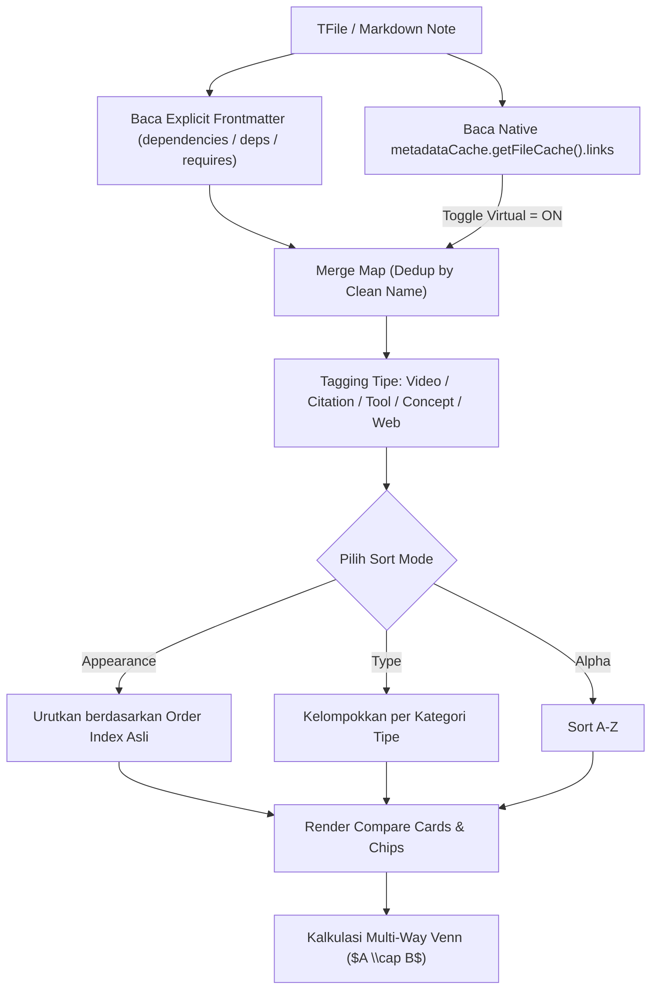

# 📋 Brief: Virtual Frontmatter Dependencies & Smart Link Sorter

> **Feature Status**: `0` (Draft / Pending Implementation)  
> **Target Module**: `pakcli-panel` (`panel`)  
> **Location**: `panel/src/features/tierlist/views/comparison-view.ts` & `venn-utils.ts`  
> **Platform**: Obsidian Desktop & Mobile (`obsidian` API / MetadataCache / Multi-Way Venn)  
> **Date**: 2026-10-22  

---

## 1. Executive Summary & Core Objective

Sering kali pengguna malas atau lupa menuliskan relasi di YAML frontmatter (`dependencies: [...]`), padahal di dalam teks catatan (body markdown) mereka sudah menulis banyak Wikilink internal (`[[catatan]]`) dan link eksternal (YouTube, web, video).

Fitur ini memperkenalkan **Virtual Frontmatter Dependencies Engine** dan **Smart Link Sorter** di dalam modul Compare Hub `pakcli-panel`:

1. **Auto-Extract Body Wikilinks (Virtual Dependencies)**:
   - Jika opsi toggle aktif, parser otomatis menyedot semua `[[wikilink]]` yang di-mention di body markdown secara berurutan (*first mentioned* $\rightarrow$ *last mentioned*).
   - Membaca langsung dari cache native Obsidian (`app.metadataCache.getFileCache(file)?.links`) untuk performa instan $0\text{ ms}$ tanpa parsing regex berat.
2. **Universal Dependencies Classification**:
   - Mendeteksi tipe link secara otomatis:
     - 🎬 **Video/Media**: YouTube URL atau video preview (`youtu.be`, `youtube.com`).
     - 📄 **Citations / Papers**: File dari folder sitasi atau berawalan `cite-`.
     - 🛠️ **Tools / Hardware**: File dari folder tools atau berawalan `tool-`.
     - 💡 **Concepts / Notes**: Wikilink catatan umum.
     - 🌐 **Web**: URL `http://` / `https://` umum.
3. **Smart Sorting Modes**:
   - **Appearance (Default)**: Berdasarkan urutan pertama kali di-mention di body (menjaga alur narasi).
   - **Categorical (Type Priority)**: Dikelompokkan rapi (Video $\rightarrow$ Paper $\rightarrow$ Tool $\rightarrow$ Concept $\rightarrow$ Web).
   - **Alphabetical (A - Z)**: Berurutan abjad.
4. **Visual Differentiation di UI Compare**:
   - **Explicit Frontmatter**: Tampil dengan badge solid (e.g., `🔗 [[doc]]`).
   - **Virtual Body Mention**: Tampil dengan badge berikon glow/sparkle (e.g., `✨ [[doc]]` atau tooltip *"Mentioned in Body Paragraph #1"*).
5. **Auto-Connected Multi-Way Venn**:
   - Diagram Venn interaktif otomatis mendeteksi irisan ($A \cap B \dots \cap N$) berbasis dependensi virtual tanpa perlu input manual di frontmatter!

---

## 2. Arsitektur Data & Tipe Interface

```typescript
export interface EnhancedDependencyItem {
    raw: string;                 // e.g. "[[python-guide]]" atau "https://youtu.be/..."
    cleanName: string;           // e.g. "python-guide"
    type: 'video' | 'citation' | 'tool' | 'concept' | 'web';
    isVirtual: boolean;          // true jika disedot dari body, false jika dari frontmatter
    orderIndex: number;          // Posisi urutan kemunculan di file
    occurrenceLine?: number;     // Baris tempat link ditemukan (dari cache link)
}

export interface DependencyExtractOptions {
    includeVirtual: boolean;     // Toggle Virtual Dependencies (Default: true)
    sortBy: 'appearance' | 'type' | 'alpha'; // Default: 'appearance'
    maxBodyLinks?: number;       // Batas maksimal body links agar tidak bloated (Default: 50)
}
```

---

## 3. Alur Kerja (Workflow Diagram)



---

## 4. UI/UX Interaction Points di Compare Modal

1. **Header Toggle Bar**:
   - Pill Toggle: `✨ Virtual Dependencies: ON / OFF`
   - Dropdown Sorter: `🔀 Sort: Appearance | Category | A-Z`
2. **Card Column View**:
   - Di bagian `Dependencies & Accessories`:
     - Chip reguler: `🔗 [[Alat Solder]]`
     - Chip virtual: `✨ [[Teorema Siku-siku]]` (dengan tooltip: *"Ditemukan di Paragraf 2"*).
3. **Diagram Venn Canvas**:
   - Node bubble irisan tengah ($A \cap B$) otomatis menyala jika kedua file memiliki mention body link yang sama.

---

## 5. Implementation & Verification Gates

- [x] Brief Status 0 dibuat di `panel/docs/brief-virtual-frontmatter-dependencies.md`.
- [ ] Commit status 0 ke git tracking:
  ```bash
  git add panel/docs/brief-virtual-frontmatter-dependencies.md
  git commit -m "docs(panel): add brief for virtual frontmatter dependencies (status 0)"
  ```
- [ ] Implementasi fungsi `getEnhancedDependencies()` di `panel/src/features/tierlist/views/comparison-view.ts`.
- [ ] Integrasi toggle UI di header `CompareModal` / `renderCompareView`.
- [ ] Verifikasi sinkronisasi dengan kalkulator Diagram Venn (`computeMultiWayVenn`).
- [ ] Build verification: Jalankan `npm run build` di `panel/` dan pastikan 0 error serta ukuran bundle $< 5.0\text{ MB}$.
- [ ] Update Brief Status ke `1` (Implemented).
